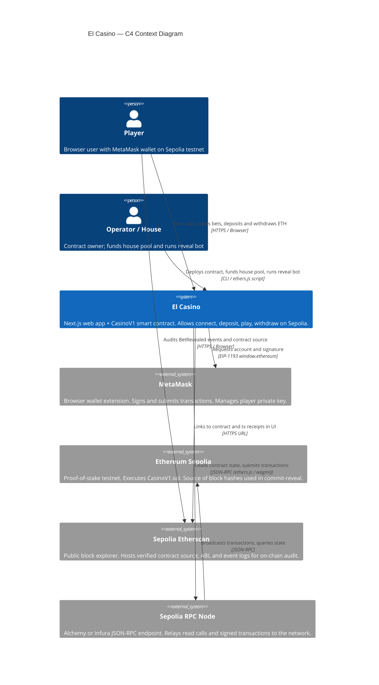
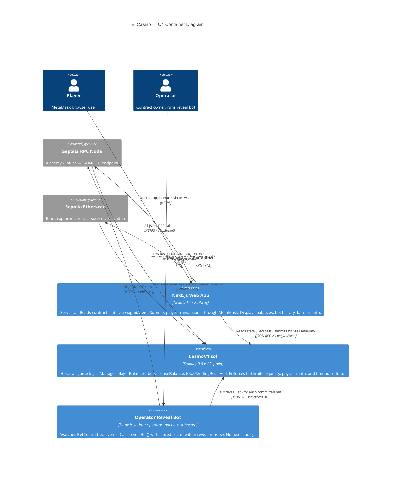

# Architecture Overview — El Casino

## System Overview

El Casino is a two-component system: a Next.js web application served from Railway and a single Solidity smart contract (`CasinoV1.sol`) deployed on the Ethereum Sepolia testnet. Players connect MetaMask, deposit testnet ETH into the contract, and play a provably-fair coin-flip game using a commit-reveal two-transaction pattern. The frontend communicates with the contract via an Alchemy or Infura JSON-RPC endpoint using the wagmi/viem library. All game state — balances, bets, outcomes, and payouts — lives on-chain. The operator runs an off-chain reveal bot that completes each bet round; if the operator fails to reveal within 256 blocks, the player can claim a full refund enforced entirely by the contract with no operator participation required.

---

## C4 Context Diagram

The diagram below shows the system as a black box surrounded by external actors and systems.



Standalone diagram: [`diagrams/c4-context.mmd`](diagrams/c4-context.mmd)

---

## C4 Container Diagram

The diagram below shows the internal deployable units of El Casino and how they communicate.



---

## Component Decisions

Each major technical choice is documented in a dedicated ADR. Brief rationale is here; full analysis in the ADRs.

| Component | Choice | ADR |
|---|---|---|
| Smart contract structure | Single `CasinoV1.sol` — all game logic, balances, and lifecycle in one contract | [ADR-001](adrs/adr-001-single-contract.md) |
| Randomness mechanism | Commit-reveal (`commitHash = keccak256(abi.encodePacked(secret))`); `block.prevrandao` mixes in at reveal | [ADR-002](adrs/adr-002-commit-reveal.md) |
| Frontend stack | Next.js 14 + wagmi v2 + viem — typed contract bindings, MetaMask hooks, React-first | [ADR-003](adrs/adr-003-frontend-stack.md) |
| Payout arithmetic | Basis-points integer math: `payout = (betAmount * (10000 - HOUSE_EDGE_BPS)) / 5000`; no floating point | [ADR-004](adrs/adr-004-payout-math.md) |
| Deployment pipeline | Foundry `forge` for contract deploy + Etherscan verify; Railway for frontend; GitHub Actions for CI | [ADR-005](adrs/adr-005-deployment.md) |

---

## NFR Mapping

Every NFR from the SRS maps to a concrete mechanism. Status legend: `met` = mechanism identified; `partially met` = gap noted; `at risk` = open question.

| NFR | Requirement | Mechanism | Status |
|---|---|---|---|
| NFR1 | UI p95 < 2 000 ms (non-transaction reads) | wagmi reactive hooks (`useReadContract`) avoid polling; Railway CDN serves static assets; RPC calls to Alchemy are low-latency. History load limited to last 10 000 blocks (FR27). | met |
| NFR2 | Tx confirmation within 1 Sepolia block (~12 s); no manual refresh | wagmi `useWaitForTransactionReceipt` subscribes to confirmation event; `tx.wait(1)` in bot. Frontend state updates reactively on receipt. | met |
| NFR3 | No private keys in frontend code or committed config | MetaMask signs all player transactions via EIP-1193; no private key ever enters Next.js code. Operator reveal-bot key in server-side env vars only, never committed. | met |
| NFR4 | Owner-only functions protected by `onlyOwner` | OpenZeppelin `Ownable` applied to `revealBet`, `houseDeposit`, `houseWithdraw`. Any other caller receives EVM revert. | met |
| NFR5 | `withdraw()` and `claimTimeout()` reentrancy-safe | Checks-effects-interactions on both functions (balance deducted before ETH transfer). OpenZeppelin `ReentrancyGuard` (`nonReentrant` modifier) applied as defense-in-depth. | met |
| NFR6 | Frontend URL >= 99% uptime over 48-hour evaluation window | Railway managed hosting with automatic restarts. UptimeRobot synthetic monitor at 1-minute intervals. Static Next.js export means no server crash loses gameplay (contract is source of truth). | met |
| NFR7 | `BetRevealed` event contains all inputs to recompute outcome | `BetRevealed` logs: `betId, player, choice, outcome, amount, payout, secret, blockHashUsed`. Any observer runs `keccak256(abi.encodePacked(secret, blockHashUsed)) % 2` and compares to `outcome`. | met |
| NFR8 | `HOUSE_EDGE_BPS` immutable after deployment | Declared `uint256 public constant HOUSE_EDGE_BPS = 200` in contract. Solidity `constant` cannot be modified post-deploy; verified on Etherscan source. | met |
| NFR9 | Contract source verified on Sepolia Etherscan | `forge verify-contract` run as part of deployment script (ADR-005). ABI and source publicly readable before public URL is live. | met |
| NFR10 | Usable on 320 px mobile viewport | Next.js with Tailwind CSS responsive classes; no horizontal overflow. Tested at 320 px during QA. | partially met — QA verification required before delivery |
| NFR11 | Contract reverts with descriptive `require()` messages | All `require()` calls include string reason matching FR37 canonical messages (e.g., "Insufficient casino balance", "Max pending bets reached", "Insufficient house liquidity"). | met |

---

## Resolved SA Open Questions

The following questions were raised in the SRS and are closed at architecture level.

### Q1 — Single vs. dual `require()` for liquidity checks

**Decision: single `require()` using the FR18/BR5 portfolio formula.**

FR18's formula `houseBalance * 100 >= totalPendingReserved * 110 + betAmount * 196` is strictly tighter than FR17's per-bet formula `houseBalance - totalPendingReserved >= betAmount * 196 / 100`. Any bet that passes FR18 also passes FR17. A single `require()` with the FR18 formula satisfies both R20 and R21. A second `require()` for FR17 would be redundant dead code — it could never trigger — and would only mislead future readers.

Keeping two checks would also create a question of error message: which check fires first? The portfolio check (FR18) is the true binding constraint; its error message "Insufficient house liquidity" is the correct one to surface.

**Implementation**: one `require()`:
```
require(
    houseBalance * 100 >= totalPendingReserved * 110 + betAmount * 196,
    "Insufficient house liquidity"
);
```

### Q2 — Payout arithmetic overflow

**Decision: closed, non-issue.**

Maximum bet is 0.1 ETH = 1e17 wei. The payout formula multiplies by 9800 before dividing: `1e17 * 9800 = 9.8e20`. Solidity `uint256` max is approximately `1.15e77`. No overflow is possible. Solidity 0.8.x checked arithmetic would revert anyway before any silent overflow. Q2 is closed.

### Q5 — Contract-level deposit range enforcement

**Decision: add `require()` guards in `deposit()`.**

Client-side validation is bypassable by anyone calling the contract directly (e.g., via Etherscan or a script). The contract enforces bet range (FR16a), pending count (FR16b), and liquidity (FR18) — consistency demands deposit limits be enforced at the same layer. The additional gas cost is negligible (two comparisons). BR9 documents the risk.

**Implementation**: add to `deposit()`:
```
require(msg.value >= MIN_BET, "Deposit below minimum");
require(msg.value <= MAX_BET, "Deposit above maximum");
```

Note: `MIN_BET` and `MAX_BET` are reused from bet range constants (both 0.001 ETH / 0.1 ETH), so no new storage is needed.

### Q8 — `revealBet()` after 256-block blockhash window

**Decision: revert if `blockhash(commitBlock)` returns `bytes32(0)`.**

The EVM only retains the last 256 block hashes. If `revealBet()` is called after this window, `blockhash(commitBlock)` returns `bytes32(0)`. Proceeding with `bytes32(0)` as entropy would make the outcome deterministic (the secret alone determines it, which the operator knows before calling), violating the fairness invariant. The correct action is to revert with "Blockhash expired; player may claim timeout". The player can then call `claimTimeout()` for a full refund. This is the safe path: the player is not harmed (full refund available), and the outcome is never computed with degraded entropy.

**Implementation**: in `revealBet()`, after computing `blockHashUsed`:
```
bytes32 blockHashUsed = blockhash(bets[betId].blockNumber);
require(blockHashUsed != bytes32(0), "Blockhash expired; player may claim timeout");
```

### F15 — `houseWithdraw` guard (addition form)

**Decision: use addition form to eliminate underflow risk.**

The SRS API contract shows `houseBalance - totalPendingReserved >= amount`. This subtraction can underflow if `totalPendingReserved > houseBalance` due to a bug, reverting with a misleading arithmetic error rather than a clear liquidity message. The addition form `houseBalance >= totalPendingReserved + amount` is semantically identical when both sides are non-negative but cannot underflow.

**Implementation**:
```
require(
    houseBalance >= totalPendingReserved + amount,
    "Would drain reserved funds"
);
```

---

## Security Posture

### Threat Model

| Threat | Mitigation |
|---|---|
| Reentrancy on `withdraw()` or `claimTimeout()` | Checks-effects-interactions pattern (balance deducted before ETH transfer) + OpenZeppelin `ReentrancyGuard` (`nonReentrant` modifier) on both functions (NFR5) |
| Operator front-running reveal | Impossible. The player's `choice` is locked in `BetCommitted` before the operator sees any bet outcome. The operator commits a hash of their secret before the bet is placed; they cannot change the secret after seeing the choice. |
| Operator refusing to reveal (liveness failure) | `claimTimeout()` enforced entirely by the contract with no operator participation: after 256 blocks, any player calls it and receives a full refund. No trust in operator liveness required for fund recovery. |
| Integer overflow in payout math | Solidity 0.8.x checked arithmetic reverts on overflow. Maximum intermediate value `1e17 * 9800 = 9.8e20` is far below `uint256` max (~1.15e77). (See Q2 resolution above.) |
| Over-withdrawal by house operator draining reserved funds | Addition-form guard on `houseWithdraw`: `houseBalance >= totalPendingReserved + amount`. Operator cannot withdraw funds reserved against pending bets. (See F15 resolution above.) |
| `blockhash` manipulation or MEV manipulation of randomness | Commit-reveal ensures the operator's secret is committed before the block that provides entropy. A miner/validator can influence `block.prevrandao` but cannot know the operator's secret; the player cannot influence the block. This is acceptable for a testnet MVP — not suitable for mainnet high-value bets. |
| Direct contract calls bypassing frontend validation | All invariants (bet range, pending count, liquidity) enforced by `require()` in the contract. Frontend validation is UX; contract validation is security. (See Q5 resolution.) |
| Private key exposure | MetaMask holds all player keys. Operator reveal-bot key is in server-side environment variables only; never in the Next.js codebase or any committed file. |
| Unauthorized access to owner functions | OpenZeppelin `Ownable` restricts `revealBet`, `houseDeposit`, `houseWithdraw` to `owner` address set at deploy time. |

### Owner Role Scope

The contract owner can: call `revealBet()` (required for game operation), call `houseDeposit()` (fund the house pool), call `houseWithdraw()` (withdraw unreserved house funds). The owner cannot: access player balances, override bet outcomes after commitment, change `HOUSE_EDGE_BPS`, modify `TIMEOUT_BLOCKS`, or block a player from calling `claimTimeout()`.

---

## Observability

### Signals

**CasinoV1.sol — on-chain events (primary signals)**

All events are indexed and queryable via `eth_getLogs` against Sepolia. The frontend uses wagmi's `watchContractEvent` for real-time updates; the reveal bot uses ethers.js event listeners.

| Event | Trigger | Key fields | What it signals |
|---|---|---|---|
| `Deposited(player, amount)` | `deposit()` success | player (indexed), amount | Player funds in; balance should increase |
| `Withdrawn(player, amount)` | `withdraw()` success | player (indexed), amount | Player funds out; balance should decrease |
| `BetCommitted(betId, player, amount, commitHash, choice, blockNumber)` | `commitBet()` success | betId (indexed), player (indexed) | New bet in Committed state; reveal bot must act within 256 blocks |
| `BetRevealed(betId, player, choice, outcome, amount, payout, secret, blockHashUsed)` | `revealBet()` success | betId (indexed), player (indexed), secret, blockHashUsed | Bet resolved; independent verifiability signal — observer can recompute outcome |
| `BetRefunded(betId, player, amount)` | `claimTimeout()` success | betId (indexed), player (indexed) | Liveness failure detected; operator did not reveal in time |
| `HouseDeposited(amount)` | `houseDeposit()` success | amount | House pool funded |
| `HouseWithdrawn(amount)` | `houseWithdraw()` success | amount | House pool drained |

**Next.js Web App — frontend signals**

- React error boundaries capture unhandled component errors; surfaced as visible error states per FR37.
- Each async operation (connect, deposit, commit, withdraw) logs start/success/failure to browser console with transaction hash where available.
- wagmi internal errors (provider disconnect, chain switch failure) surfaced as user-readable messages per FR37.

**Operator Reveal Bot — process signals**

- Logs `BetCommitted` event receipt with betId and blockNumber.
- Logs `revealBet()` tx submission with betId and tx hash.
- Logs `BetRevealed` confirmation or revert reason.
- Alerts (via log monitoring or simple email) if any betId has `block.number > commitBlock + 200` without a successful reveal (early warning before 256-block timeout).

### SLO Candidates

Tied to NFRs from the SRS:

| SLO | Measurement | NFR |
|---|---|---|
| SLO1: App page load p95 < 2 000 ms | Measured from Railway response; UptimeRobot synthetic check records response time at 1-minute intervals during evaluation window | NFR1 |
| SLO2: Bet reveal latency p95 < 5 Sepolia blocks (~60 s) from `BetCommitted` event to `BetRevealed` event | Computed from `BetCommitted.blockNumber` vs `BetRevealed` tx blockNumber; operator bot monitors and alerts at block 200 | NFR2 |
| SLO3: Frontend availability >= 99% of requests over 48-hour evaluation window | UptimeRobot 1-minute interval HTTP 200 checks | NFR6 |
| SLO4: 100% of `BetRevealed` events are independently recomputable | Spot-check: observer takes `secret` and `blockHashUsed` from event, runs `keccak256(abi.encodePacked(secret, blockHashUsed)) % 2`, compares to `outcome` field | NFR7 |

### Oncall Visibility

A conceptual oncall dashboard covers:

1. **Frontend health**: UptimeRobot HTTP check on Railway URL; alert on first failure.
2. **Bet reveal backlog**: count of `BetCommitted` events with no corresponding `BetRevealed` within 200 blocks. Non-zero count triggers operator alert; reaching 256 blocks means players can claim refunds (reputational and financial risk).
3. **House balance vs. reserved**: `houseBalance - totalPendingReserved` read from contract. Near-zero gap means no new bets will be accepted; operator must call `houseDeposit()`.
4. **Refund events**: any `BetRefunded` emission means the reveal bot failed; root-cause required.
5. **Contract revert spike**: unusually high revert rate on `commitBet()` may indicate liquidity exhaustion or a frontend validation gap.

### Top Failure Scenarios and Detection

| Failure Scenario | Detection Signal | Response |
|---|---|---|
| Frontend unreachable | UptimeRobot HTTP check fails (SLO3) | Railway restart; check Railway logs |
| Reveal bot down (operator liveness failure) | `BetCommitted` events with no `BetRevealed` after 200 blocks | Restart bot; if > 256 blocks, players claim refunds automatically |
| House liquidity exhausted | `commitBet()` reverts with "Insufficient house liquidity" spike | Operator calls `houseDeposit()` |
| Contract not verified on Etherscan | Manual check pre-launch; NFR9 gate | Re-run `forge verify-contract` |
| RPC endpoint down | All `eth_call` and `eth_sendTransaction` fail; frontend shows error states | Switch to backup RPC URL in env var |

---

## Deployment Architecture

### Smart Contract Deployment

```
forge script script/DeployScript.s.sol \
  --rpc-url $SEPOLIA_RPC_URL \
  --broadcast \
  --verify \
  --etherscan-api-key $ETHERSCAN_API_KEY
```

Post-deploy steps (manual, one-time):
1. Operator calls `houseDeposit()` with 10 ETH to fund house pool.
2. Confirm `HouseDeposited` event on Etherscan.
3. Set `NEXT_PUBLIC_CONTRACT_ADDRESS` env var in Railway.

### Frontend Deployment

- Repository: GitHub. Branch `main` triggers Railway deploy via GitHub integration.
- Build command: `npm run build` (Next.js static export or server-side render).
- Environment variables in Railway (never committed to repo):
  - `NEXT_PUBLIC_CONTRACT_ADDRESS` — deployed CasinoV1 address
  - `NEXT_PUBLIC_RPC_URL` — Alchemy/Infura Sepolia endpoint
  - `NEXT_PUBLIC_CHAIN_ID` — `11155111` (Sepolia)

### Reveal Bot Deployment

- Node.js script run on operator machine or a lightweight Railway worker service.
- Environment variables: `OPERATOR_PRIVATE_KEY`, `CONTRACT_ADDRESS`, `RPC_URL`, `DATABASE_URL` — stored in server environment only.
- Watches `BetCommitted` events; calls `revealBet()` for each. Persists secret-to-betId mapping to a PostgreSQL or Redis store keyed by betId. On restart, the bot reconnects to the store and resumes processing any unresolved bets. Deterministic secret derivation was evaluated and rejected (ARCH-Q1 resolved 2026-05-31).

### No Private Keys in Frontend

Verified by: grep for `PRIVATE_KEY` in Next.js codebase returns no results. MetaMask handles all player signing via EIP-1193. Operator key is in bot process env only.

---

## ADR Index

| ADR | Title | Status |
|---|---|---|
| [ADR-001](adrs/adr-001-single-contract.md) | Single-contract architecture | Accepted |
| [ADR-002](adrs/adr-002-commit-reveal.md) | Commit-reveal randomness | Accepted |
| [ADR-003](adrs/adr-003-frontend-stack.md) | Frontend stack — Next.js + wagmi/viem | Accepted |
| [ADR-004](adrs/adr-004-payout-math.md) | Integer arithmetic for payout (basis points) | Accepted |
| [ADR-005](adrs/adr-005-deployment.md) | Deployment pipeline — Foundry + Railway + Etherscan | Accepted |

---

## Open Questions

| ID | Question | Owner | Blocker? |
|---|---|---|---|
| ~~Q7~~ | ~~BRD U1: Is commit-reveal sufficient?~~ **RESOLVED:** Commit-reveal confirmed as sufficient by operator (2026-05-31). See [[adr-002-commit-reveal\|ADR-002]]. No VRF needed. | — | No |
| ~~ARCH-Q1~~ | ~~Reveal bot persistence strategy.~~ **RESOLVED:** DB persistence (PostgreSQL/Redis) confirmed by operator (2026-05-31). Deterministic derivation rejected. See Reveal Bot Deployment section above. | — | No |
