# System Requirements Specification — El Casino

## Scope

El Casino is a single-game (coin flip) browser-based casino smart contract system deployed on the Ethereum Sepolia testnet. The system allows a player to connect MetaMask, deposit testnet ETH, place provably-fair bets using a commit-reveal two-transaction pattern, receive on-chain outcomes, and withdraw their balance. The operator manages house liquidity by interacting directly with the deployed contract.

---

# Functional Requirements

## @wallet — Wallet & Network

- FR1 [must] @wallet The frontend must detect whether `window.ethereum` is present and expose a `connectWallet()` action that calls `eth_requestAccounts` via the EIP-1193 provider. If `window.ethereum` is absent, display the MetaMask-not-found error state (AC1.4). <- R1, US1
- FR2 [must] @wallet After successful connection, the frontend must read the connected account address and display it in truncated form (e.g., `0xABCD…1234`). <- R1, US1
- FR3 [must] @wallet The frontend must check `eth_chainId` after every connect event and whenever `chainChanged` fires. If chain ID is not `0xaa36a7` (Sepolia), display the wrong-network prompt and offer a one-click `wallet_switchEthereumChain` call (AC1.5, AC1.6). <- R2, US1
- FR4 [must] @wallet A disconnect action must clear wallet state in the frontend and return the UI to the pre-connected landing state without a page reload (AC1.7). <- R1, US1
- FR5 [must] @wallet If the user rejects the MetaMask connection prompt (EIP-1193 error code 4001), the frontend must return to the disconnected state with no crash (AC1.8). <- R11, US1

## @deposit — Deposit

- FR6 [must] @deposit The frontend must expose a deposit form (enabled only when connected and on Sepolia) with a numeric ETH amount input. On submit it calls the contract's `deposit()` payable function with `msg.value` equal to the entered amount. <- R3, US2
- FR7 [must] @deposit The frontend must validate the deposit amount client-side: amount >= 0.001 ETH and <= 0.1 ETH and <= player wallet balance. Validation errors are shown inline before the MetaMask prompt is triggered (AC2.8, AC2.11). <- R3, US2
- FR8 [must] @deposit The contract's `deposit()` function must credit the `msg.value` to `playerBalances[msg.sender]` atomically. It must emit a `Deposited(address indexed player, uint256 amount)` event. <- R3, US2
- FR9 [must] @deposit After 1 block confirmation of the deposit transaction, the frontend must re-read the player's on-chain balance and update the displayed casino balance (AC2.5). <- R3, R4, US2
- FR10 [must] @deposit The player's casino balance must be readable at any time via a view function `getBalance(address player)` and displayed continuously while connected (AC2.10). <- R4, US2
- FR11 [should] @deposit The UI must display a link to a Sepolia faucet (e.g., `https://sepoliafaucet.com`) near the deposit form (AC2.9). <- R13, US2

## @gameplay — Bet Commit

- FR12 [must] @gameplay The frontend must expose a bet form (enabled only when connected, on Sepolia, and casino balance > 0). The player enters a bet amount and selects Heads or Tails before the "Play" button activates (AC3.1, AC3.4). <- R5, US3
- FR13 [must] @gameplay The frontend must validate the bet amount: amount >= 0.001 ETH, amount <= 0.1 ETH, amount <= player casino balance. It must also reject if the player already has 2 pending bets (AC3.2, AC3.13). These checks run before the MetaMask prompt. <- R5, R19, US3
- FR14 [must] @gameplay The UI must display "House edge: 2%. Winning payout: 1.96× your bet." adjacent to the bet input at all times (AC3.3). <- R7, R8, US3
- FR15 [must] @gameplay To commit a bet the player calls `commitBet(uint256 betAmount, bytes32 commitHash, uint8 choice) external` (non-payable). The frontend generates a cryptographically random `secret` (uint256) off-chain, computes `commitHash = keccak256(abi.encodePacked(secret))`, then calls `commitBet(betAmount, commitHash, choice)`. The function is NOT payable and does NOT accept `msg.value`; it deducts `betAmount` from `playerBalances[msg.sender]`. The frontend stores `secret` locally until the operator reveal is confirmed. `choice` is 0 (Heads) or 1 (Tails). <- R5, R6, US3
- FR16 [must] @gameplay The contract's `commitBet()` function must: (a) enforce bet range (>= 0.001 ETH, <= 0.1 ETH); (b) enforce the per-player pending bet limit of 2 (R19); (c) run the per-bet liquidity check (R20); (d) run the portfolio liquidity check (R21); (e) deduct the bet from `playerBalances[msg.sender]`; (f) record the bet in `bets[betId]` with status `Committed`; (g) add `1.96 × bet` to `totalPendingReserved`; (h) emit `BetCommitted(betId, player, amount, commitHash, choice, block.number)`. <- R5, R6, R7, R19, R20, R21, US3
- FR17 [must] @gameplay Liquidity check — per-bet (R20): `houseBalance - totalPendingReserved >= 1.96 × newBet`. If false, revert with reason `"Insufficient house liquidity"`. <- R20, US3
- FR18 [must] @gameplay Liquidity check — portfolio (R21): `houseBalance * 100 >= totalPendingReserved * 110 + betAmount * 196`. Plain-English: the house pool must cover all currently reserved payouts (the running total of `1.96 × amount` for each committed unrevealed bet, multiplied by a 1.10 safety buffer) plus the new bet's potential payout (1.96×, added in full without the buffer). `totalPendingReserved` is the raw running sum of `1.96 × amount` (expressed as `amount * 196 / 100`) for each committed unrevealed bet; the 1.10 factor is applied to the entire pool at check time. This check is the binding constraint (strictly tighter than FR17's per-bet check) and satisfies both R20 and R21. If false, revert with reason `"Insufficient house liquidity"`. <- R21, US3

  > Q1: FR17 and FR18 both guard liquidity but FR18 is strictly tighter. FR17 is retained as an explicit documentation of the simpler invariant per R20; in implementation a single check using the FR18 formula satisfies both R20 and R21. Confirm with architect whether to keep as one or two require() calls.

- FR19 [must] @gameplay While a player has at least one committed, unrevealed bet, the frontend must display "Waiting for result..." with the pending bet amount and a "Claim timeout refund" button that becomes enabled after the timeout block height is reached (AC3.16). <- R5, US3

## @gameplay — Bet Reveal (Operator)

- FR20 [must] @gameplay The operator (contract owner) calls `revealBet(uint256 betId, bytes32 secret)`. The contract must: (a) verify `keccak256(abi.encodePacked(secret)) == bets[betId].commitHash`; (b) derive `outcome = uint256(keccak256(abi.encodePacked(secret, blockhash(bets[betId].blockNumber)))) % 2`; (c) compare outcome to `bets[betId].choice`; (d) if win: add `bet × 1.96` to `playerBalances[player]`; if loss: add `bet` to `houseBalance`; (e) subtract `1.96 × bet` from `totalPendingReserved`; (f) mark bet status `Win` or `Loss`; (g) emit `BetRevealed(betId, player, choice, outcome, bet, payout, secret, blockhash)`. <- R5, R6, R7, US3
- FR21 [must] @gameplay The payout multiplier on win must equal exactly `(10000 - 200) / 5000 = 1.96`, expressed in the contract as integer arithmetic: `payout = (bet × 9800) / 5000`. The house edge constant must be `HOUSE_EDGE_BPS = 200` (200 basis points = 2%), stored as an immutable or constant. <- R7, US3

  > Q2: `bet × 9800 / 5000` requires bet to be a uint256 with enough room (no overflow for bets <= 0.1 ETH at 1e18 wei). Verify with architect that 0.1 ETH × 9800 = 980000000000000000 fits in uint256 (trivially yes). Formula is `(amount * (10000 - HOUSE_EDGE_BPS)) / 5000`.

- FR22 [must] @gameplay `revealBet()` must be restricted to the contract owner (OpenZeppelin `Ownable` `onlyOwner` modifier). <- R6, US3

## @gameplay — Timeout Refund

- FR23 [must] @gameplay The contract must define `TIMEOUT_BLOCKS = 256`. A player calls `claimTimeout(uint256 betId)` if `block.number > bets[betId].blockNumber + TIMEOUT_BLOCKS` and the bet is still in `Committed` status. The contract must: (a) validate the caller is `bets[betId].player`; (b) validate the timeout has elapsed; (c) refund `bet.amount` to `playerBalances[player]` (full refund, no house edge); (d) subtract `1.96 × bet` from `totalPendingReserved`; (e) mark status `Refunded`; (f) emit `BetRefunded(betId, player, amount)`. <- R5, US3 AC3.17

  > Q3 RESOLVED (2026-05-31): 256 blocks at ~12 s/block ≈ 51 minutes. Confirmed by operator as acceptable. Operator runs an automated reveal bot; 256 blocks is a generous margin. `TIMEOUT_BLOCKS = 256` is final.

- FR24 [must] @gameplay The frontend must show a "Claim timeout refund" button for any pending bet where `currentBlock > commitBlock + 256`. The button calls `claimTimeout(betId)`. It must show a loading state while the transaction is pending (AC3.17). <- R5, R11, R12, US3

## @gameplay — History

- FR25 [should] @gameplay The frontend must display a game history panel on the main page showing at least the last 5 completed rounds for the connected address, derived from `BetRevealed` events filtered by player address (AC4.4, AC4.5). Each row shows: round ID, bet amount, player choice, outcome (Win/Loss), payout. <- R14, US4
- FR26 [should] @gameplay Each completed round row must include the reveal transaction hash as a clickable Sepolia Etherscan link (AC4.2). <- R10, US4
- FR27 [should] @gameplay The frontend must load the last 20 `BetRevealed` events (max) for the player using `eth_getLogs` with a block range limited to the last 10 000 blocks, preventing slow genesis-to-tip scans (Q_US4_1). <- R14, US4

## @withdraw — Withdrawal

- FR28 [must] @withdraw The frontend must expose a withdrawal form with an amount input (or "Withdraw all") that is enabled only when casino balance > 0. Client-side validation: amount >= 0.001 ETH and amount <= casino balance (AC5.2, AC5.3, AC5.10). <- R9, US5
- FR29 [must] @withdraw The player calls `withdraw(uint256 amount)`. The contract must: (a) verify `playerBalances[msg.sender] >= amount`; (b) deduct `amount` from `playerBalances[msg.sender]` before the ETH transfer (checks-effects-interactions); (c) transfer `amount` wei to `msg.sender`; (d) emit `Withdrawn(address indexed player, uint256 amount)`. <- R9, US5
- FR30 [must] @withdraw Only the account that owns a casino balance may withdraw it; the contract enforces this via `msg.sender` as the key into `playerBalances` (AC5.9). <- R9, US5
- FR31 [must] @withdraw After 1 block confirmation, the frontend re-reads `getBalance(msg.sender)` and updates the displayed casino balance (AC5.6). <- R9, US5

## @fairness-audit — Verifiability

- FR32 [should] @fairness-audit The app must include a "How to Verify" section accessible from the main navigation without connecting a wallet (AC6.3). It must explain in plain language: (a) how to find a round's `BetRevealed` event on Etherscan; (b) how to recompute `outcome = keccak256(secret, blockhash) % 2` from event data; (c) how to confirm payout arithmetic. <- R15, US6
- FR33 [should] @fairness-audit The "How to Verify" section must state the commit-reveal mechanism and explicitly disclose the operator griefing limitation (operator could withhold reveal until timeout) (AC6.4). <- R15, US6
- FR34 [must] @fairness-audit The deployed contract address and a direct Sepolia Etherscan link to it must be visible in the app UI at all times, including when no wallet is connected (AC6.1). <- R16, US6
- FR35 [must] @fairness-audit The "How to Verify" section must include a short Python or JavaScript snippet that recomputes an outcome from raw event data. Operator confirmed inclusion required. <- R15, US6

## @General — Cross-Cutting

- FR36 [must] @General For every async operation (connect, deposit, commit, reveal-wait, withdraw, claim-timeout), the frontend must maintain a loading/pending state with a visible spinner or status message that persists until the transaction is confirmed or fails (AC loading states across all stories). <- R12, US1, US2, US3, US5
- FR37 [must] @General For every failure mode — MetaMask not installed, wrong network, insufficient balance, user rejection (error 4001), on-chain revert — the frontend must display a specific, human-readable error message. No silent failures. Error messages from AC1.4, AC2.6, AC2.7, AC3.11, AC3.12, AC5.7, AC5.8 are canonical. <- R11, US1, US2, US3, US5
- FR38 [must] @General The casino contract address and Sepolia Etherscan link (FR34) must be hard-coded in the frontend build as an environment variable (`NEXT_PUBLIC_CONTRACT_ADDRESS`). <- R16, US6

---

# Non-Functional Requirements

- NFR1 [must] @General UI response time for non-transaction operations (balance read, history load, page render) p95 < 2 000 ms under normal Sepolia RPC conditions. <- G3
- NFR2 [must] @General Transaction confirmation latency: after submitting a transaction, the frontend subscribes to the confirmation event; expected confirmation within 1 Sepolia block (~12 s). UI must not require manual refresh. <- R3, R9, G1
- NFR3 [must] @General No private keys, secrets, or operator seed phrases may appear in the frontend codebase or any committed configuration file. The operator's reveal-bot key must be stored in environment variables only. <- C6, G2
- NFR4 [must] @General The contract's owner-gated functions (`revealBet`, `houseDeposit`, `houseWithdraw`) must be protected by OpenZeppelin `Ownable` (or equivalent) `onlyOwner` modifier. No other address may call them. <- C6, G2
- NFR5 [must] @General The `withdraw()` function must follow the checks-effects-interactions pattern to prevent reentrancy: balance deducted before ETH transfer. Additionally the contract must use OpenZeppelin `ReentrancyGuard` on `withdraw()` and `claimTimeout()`. <- C6, G2
- NFR6 [must] @General The public frontend URL (Railway or equivalent) must be reachable with HTTP 200 for >= 99% of requests measured over the 48-hour evaluation window (measured via UptimeRobot or equivalent synthetic monitor at 1-minute intervals during the 48-hour evaluation window). <- C2, G1
- NFR7 [must] @General All game inputs necessary to recompute an outcome must be emitted in on-chain events. Specifically `BetRevealed` must log: `betId`, `player`, `choice`, `outcome`, `amount`, `payout`, `secret`, `blockHashUsed`. An independent observer must be able to recompute the outcome from these fields alone. <- R10, C5, G2
- NFR8 [must] @General The `HOUSE_EDGE_BPS` value (200) must be declared as a Solidity `constant` or `immutable`. It may not be changed after deployment without redeployment. <- R7, G4
- NFR9 [must] @General The contract source code must be verified on Sepolia Etherscan before the public URL is considered done (Foundry `forge verify-contract` or equivalent). ABI and source publicly readable. <- C3
- NFR10 [should] @General The app must be usable on a mobile browser viewport (320 px minimum width) with no horizontal overflow or broken layouts. <- R18, G3
- NFR11 [must] @General Smart contract functions interacting with ETH balances must revert with descriptive `require()` messages rather than silent failures. Messages must match those surfaced in FR37 error states. <- R11, G3

---

# Business Rules

- BR1 [must] @gameplay House edge is fixed at 2% (200 basis points). The winning payout formula is `(bet × 9800) / 5000`. This constant is immutable after deployment. Condition: applied on every `revealBet()` call that results in a win. Enforced at: FR21, `HOUSE_EDGE_BPS` contract constant, `BetRevealed` event. Risk if violated: player over-paid or under-paid; casino solvency error.
- BR2 [must] @gameplay Minimum bet = 0.001 ETH (1e15 wei). Maximum bet = 0.1 ETH (1e17 wei). Condition: enforced on every `commitBet()` call. Enforced at: FR16(a), FR13 client-side. Risk if violated: dust attacks or bets exceeding house reserve.
- BR3 [must] @gameplay A player may not have more than 2 committed, unrevealed bets at any time. Condition: checked on `commitBet()`. Enforced at: FR16(b), FR13 client-side. Risk if violated: player locks up excessive house reserves; potential griefing.
- BR4 [must] @gameplay Per-bet liquidity invariant: `houseBalance - totalPendingReserved >= 1.96 × newBet`. Condition: checked on `commitBet()`. Enforced at: FR17, `commitBet()` require(). Risk if violated: house cannot cover payout on win; insolvency.
- BR5 [must] @gameplay Portfolio liquidity invariant (with 10% safety factor): `houseBalance * 100 >= totalPendingReserved * 110 + betAmount * 196`. Here `totalPendingReserved` is the raw running sum of `1.96 × amount` for all currently committed unrevealed bets; the 1.10 multiplier is applied to this entire pool at check time; the new bet's potential payout (1.96×) is added in full (without the buffer). Condition: checked on every `commitBet()`. Enforced at: FR18, `commitBet()` require(). Risk if violated: multi-bet variance spike could exhaust house balance; BR5 is the binding constraint (stricter than BR4).
- BR6 [must] @gameplay A player may claim a full refund (no house edge applied) on a committed bet if and only if the reveal has not occurred within 256 blocks of the commit block. Condition: `block.number > bet.blockNumber + 256 AND bet.status == Committed`. Enforced at: FR23, `claimTimeout()`. Risk if violated: player funds locked permanently; unacceptable.
- BR7 [must] @withdraw Only `msg.sender` may withdraw from their own `playerBalances[msg.sender]` balance. No operator or third party may withdraw player funds. Condition: every `withdraw()` call. Enforced at: FR29, FR30, `msg.sender` key. Risk if violated: theft of player funds.
- BR8 [must] @gameplay The reveal secret combined with the commit block's blockhash determines the outcome; the formula `keccak256(secret, blockhash(commitBlock)) % 2` is the authoritative outcome function. Condition: every `revealBet()` call. Enforced at: FR20, `revealBet()` contract logic. Risk if violated: outcome not verifiable; G2 unmet.
- BR9 [must] @deposit Minimum deposit = 0.001 ETH. Maximum deposit = 0.1 ETH. Condition: every `deposit()` call. Enforced at: FR6, FR7 client-side. Risk if violated: dust spam; note — enforced client-side in MVP; contract-level enforcement deferred to architect decision.

  > Q5: BR9 asks whether `deposit()` should enforce min/max at the contract level. Client-side validation is bypassable. Architect to decide whether to add require() guards in `deposit()`. Raise as Q5.

---

# Data Models

## DM1 — Bet

Stored in contract mapping `bets: mapping(uint256 => Bet)`.

| Field | Type | Constraints |
|---|---|---|
| `betId` | uint256 | Auto-incrementing; unique; set at commit time |
| `player` | address | Non-zero; set at commit time |
| `amount` | uint256 | >= 1e15 wei (0.001 ETH), <= 1e17 wei (0.1 ETH) |
| `commitHash` | bytes32 | `keccak256(abi.encodePacked(secret))` — preimage is the secret alone; frontend computes this before calling `commitBet`; no betId in preimage |
| `choice` | uint8 | 0 = Heads, 1 = Tails |
| `secret` | bytes32 | Zero until revealed; set by operator at reveal |
| `outcome` | uint8 | 0 = Heads, 1 = Tails; set at reveal |
| `blockNumber` | uint256 | `block.number` at commit time; used for timeout and blockhash |
| `status` | uint8 (enum) | 0=Committed, 1=Win, 2=Loss, 3=Refunded |

## DM2 — Player Record

Stored in contract mapping `playerBalances: mapping(address => uint256)` and `pendingBetCount: mapping(address => uint256)`.

| Field | Type | Constraints |
|---|---|---|
| `address` | address | Implicit key of both mappings |
| `casinoBalance` | uint256 | >= 0; modified on deposit, win, loss, withdraw, refund |
| `pendingBetCount` | uint256 | 0–2; incremented on commit, decremented on reveal or refund |

## DM3 — Contract State

Top-level contract storage variables.

| Field | Type | Constraints |
|---|---|---|
| `owner` | address | Set at constructor; OpenZeppelin Ownable |
| `houseBalance` | uint256 | ETH held by contract for house payouts; initially 0, funded by operator |
| `totalPendingReserved` | uint256 | Running sum of `1.96 × amount` for all Committed bets |
| `nextBetId` | uint256 | Counter; starts at 1 |
| `HOUSE_EDGE_BPS` | uint256 | Constant = 200 |
| `TIMEOUT_BLOCKS` | uint256 | Constant = 256 |
| `MIN_BET` | uint256 | Constant = 1e15 |
| `MAX_BET` | uint256 | Constant = 1e17 |

---

# API Contracts

## Contract Functions

**`deposit()`**
- Visibility: `external payable`
- Auth: any connected player
- Input: `msg.value` = deposit amount (wei)
- Effect: `playerBalances[msg.sender] += msg.value`
- Emits: `Deposited(address indexed player, uint256 amount)`
- Revert conditions: None in MVP (contract-level range checks deferred per Q5). If architect adds `msg.value == 0` guard: `msg.value == 0 → "Zero deposit not allowed"`.
- Status: success or revert

**`commitBet(uint256 betAmount, bytes32 commitHash, uint8 choice)`**
- Visibility: `external` (non-payable)
- Auth: any connected player
- Input: `betAmount` = bet amount in wei (drawn from pre-deposited `playerBalances`); `commitHash` = `keccak256(abi.encodePacked(secret))`; `choice` = 0 or 1
- Pre-checks (revert if false):
  - `betAmount >= MIN_BET` — "Bet below minimum"
  - `betAmount <= MAX_BET` — "Bet above maximum"
  - `playerBalances[msg.sender] >= betAmount` — "Insufficient casino balance"
  - `pendingBetCount[msg.sender] < 2` — "Max pending bets reached"
  - `houseBalance * 100 >= totalPendingReserved * 110 + betAmount * 196` — "Insufficient house liquidity"
- Effect: deducts `betAmount` from `playerBalances[msg.sender]`; creates bet record; updates reserves
- Emits: `BetCommitted(uint256 indexed betId, address indexed player, uint256 amount, bytes32 commitHash, uint8 choice, uint256 blockNumber)`

**`revealBet(uint256 betId, bytes32 secret)`**
- Visibility: `external`
- Auth: `onlyOwner`
- Input: `betId`; `secret` (pre-image)
- Pre-checks: bet exists; status == Committed; `keccak256(abi.encodePacked(secret)) == bets[betId].commitHash`
- Effect: computes outcome; pays or collects; updates reserves; marks status
- Emits: `BetRevealed(uint256 indexed betId, address indexed player, uint8 choice, uint8 outcome, uint256 amount, uint256 payout, bytes32 secret, bytes32 blockHashUsed)`
- Revert: "Invalid secret" if hash mismatch; "Bet not pending" if status != Committed

**`claimTimeout(uint256 betId)`**
- Visibility: `external`
- Auth: `bets[betId].player` only
- Input: `betId`
- Pre-checks: `msg.sender == bets[betId].player`; `bets[betId].status == Committed`; `block.number > bets[betId].blockNumber + TIMEOUT_BLOCKS`
- Effect: refund `bet.amount` to `playerBalances[player]`; decrement `pendingBetCount`; subtract from `totalPendingReserved`; mark status `Refunded`
- Emits: `BetRefunded(uint256 indexed betId, address indexed player, uint256 amount)`
- Revert: "Not your bet"; "Bet not pending"; "Timeout not reached"

**`withdraw(uint256 amount)`**
- Visibility: `external nonReentrant`
- Auth: any player with sufficient balance
- Input: `amount` (wei)
- Pre-checks: `playerBalances[msg.sender] >= amount`; `amount > 0`
- Effect: deduct from `playerBalances[msg.sender]`; transfer ETH to `msg.sender`
- Emits: `Withdrawn(address indexed player, uint256 amount)`
- Revert: "Insufficient balance"; "Zero amount"

**`houseDeposit()`**
- Visibility: `external payable onlyOwner`
- Auth: owner only
- Input: `msg.value`
- Effect: `houseBalance += msg.value`
- Emits: `HouseDeposited(uint256 amount)`

**`houseWithdraw(uint256 amount)`**
- Visibility: `external onlyOwner nonReentrant`
- Auth: owner only
- Pre-checks: `houseBalance - totalPendingReserved >= amount` (may not drain reserved funds)
- Effect: `houseBalance -= amount`; transfer to owner
- Emits: `HouseWithdrawn(uint256 amount)`

## View Functions

**`getBalance(address player) → uint256`**
- Returns `playerBalances[player]`

**`getPendingBets(address player) → uint256[] betIds`**
- Returns array of betIds where `bets[id].player == player && bets[id].status == Committed`

**`getBet(uint256 betId) → Bet`**
- Returns full Bet struct

## Key Events

| Event | Parameters |
|---|---|
| `Deposited` | `address indexed player, uint256 amount` |
| `Withdrawn` | `address indexed player, uint256 amount` |
| `BetCommitted` | `uint256 indexed betId, address indexed player, uint256 amount, bytes32 commitHash, uint8 choice, uint256 blockNumber` |
| `BetRevealed` | `uint256 indexed betId, address indexed player, uint8 choice, uint8 outcome, uint256 amount, uint256 payout, bytes32 secret, bytes32 blockHashUsed` |
| `BetRefunded` | `uint256 indexed betId, address indexed player, uint256 amount` |
| `HouseDeposited` | `uint256 amount` |
| `HouseWithdrawn` | `uint256 amount` |

---

# State Machines

## Bet Lifecycle

```mermaid
stateDiagram-v2
    [*] --> Committed : commitBet() called; hash stored; player balance debited
    Committed --> Win : revealBet(); outcome matches player choice; payout credited
    Committed --> Loss : revealBet(); outcome does not match; bet retained by house
    Committed --> Refunded : claimTimeout(); block.number > commitBlock + 256
    Win --> [*]
    Loss --> [*]
    Refunded --> [*]
```

## Player Balance Lifecycle

```mermaid
stateDiagram-v2
    [*] --> Zero : wallet connected; no deposits
    Zero --> Funded : deposit() confirmed
    Funded --> Zero : withdraw(all) confirmed
    Funded --> Funded : deposit() / win / partial withdraw
    Funded --> Funded : commitBet() debits; revealBet() credits or not
    Funded --> Funded : loss [casinoBalance > bet.amount]
    Funded --> Zero : loss [casinoBalance == bet.amount]
```

## Contract Liquidity Lifecycle

```mermaid
stateDiagram-v2
    [*] --> Unfunded : contract deployed; houseBalance == 0
    Unfunded --> AcceptingBets : houseDeposit(); houseBalance > 0 and liquidity check passes
    AcceptingBets --> AcceptingBets : bets committed and revealed; reserves flow
    AcceptingBets --> Insufficient : commitBet() would fail liquidity check; no new bets accepted
    Insufficient --> AcceptingBets : houseDeposit() by owner; liquidity check passes again
    AcceptingBets --> Unfunded : houseWithdraw() drains all unreserved balance
```

---

# Use Cases Index

- [[uc-connect-wallet|UC1 Connect Wallet]]
- [[uc-deposit|UC2 Deposit Funds]]
- [[uc-commit-bet|UC3 Commit Bet]]
- [[uc-reveal-bet|UC4 Reveal Bet (Operator)]]
- [[uc-claim-timeout|UC5 Claim Timeout Refund]]
- [[uc-withdraw|UC6 Withdraw Balance]]
- [[uc-view-history|UC7 View Game History]]
- [[uc-verify-fairness|UC8 Verify Fairness On-Chain]]

---

# Open Questions

- Q1 FR17 vs FR18: Should `commitBet()` have two separate `require()` calls (one per-bet, one portfolio) or a single combined check? Both R20 and R21 are [must]; the portfolio check is strictly tighter. Affects implementation clarity vs. compliance. Architect to decide. If a single check is used, its formula must satisfy both R20 and R21.
- Q2 Payout arithmetic: Formula `(amount * (10000 - 200)) / 5000` confirmed correct for 1.96× payout. Architect to verify no overflow for 0.1 ETH (1e17 wei): `1e17 * 9800 = 9.8e20` which fits comfortably in uint256 (max ~1.15e77).
- ~~Q3 Timeout duration: 256 blocks ≈ 51 min on Sepolia (~12 s/block). Needs explicit operator sign-off before contract deployment.~~ RESOLVED: 256-block timeout confirmed by operator 2026-05-31. `TIMEOUT_BLOCKS = 256` is the authoritative value in FR23 and DM3. No further sign-off required before architecture.
- ~~Q4 Verification code snippet (Q_US6_2 from US6): Operator should confirm before architect allocates frontend work.~~ RESOLVED: Code snippet confirmed required by operator 2026-05-31. FR35 updated to [must]. Architect must allocate frontend work for the verification snippet.
- Q5 Contract-level deposit limits: FR7 enforces min/max deposit client-side only. Should `deposit()` also enforce these limits on-chain to prevent direct contract calls bypassing the frontend? Recommend: yes, add `require(msg.value >= MIN_BET && msg.value <= MAX_BET)` to `deposit()`. Architect to decide.
- ~~Q6 `commitBet` payable vs. non-payable: US3 and US2 imply a deposit-first architecture where bets come from `playerBalances`. Architect to confirm the function signature.~~ RESOLVED: Option A confirmed by operator 2026-05-31 — deposit-first, non-payable `commitBet`. Signature is `commitBet(uint256 betAmount, bytes32 commitHash, uint8 choice) external`. Bet deducted from `playerBalances[msg.sender]`. FR15 and API contract updated accordingly.
- Q7 BRD U1 (commit-reveal sufficient for evaluator): This uncertainty is still open. The SRS specifies commit-reveal fully. If the evaluator deems this insufficient, VRF would require a contract redesign. SA has no further input; operator must confirm before deployment.
